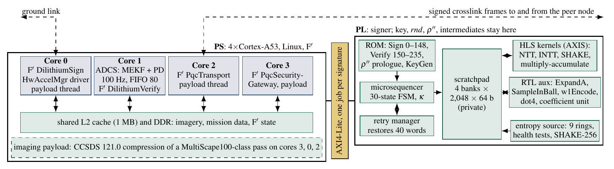
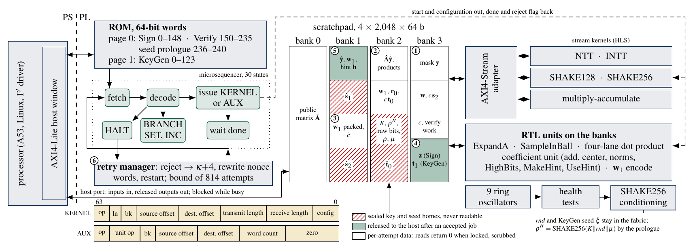
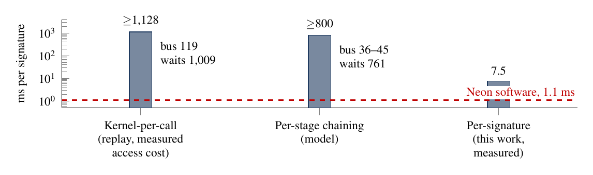
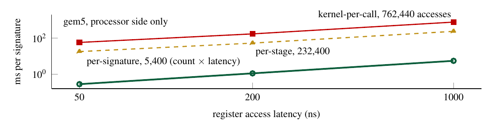
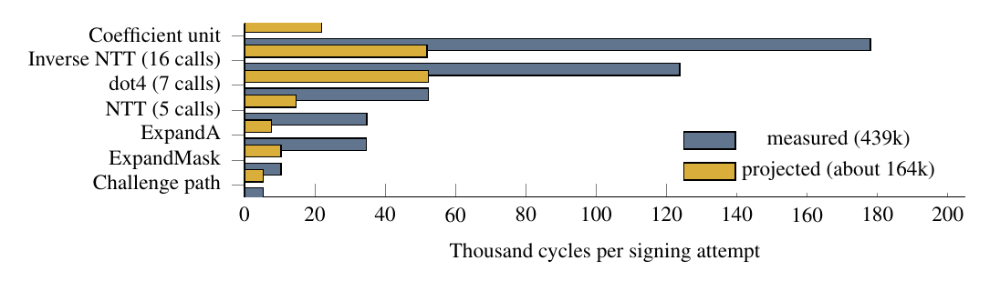
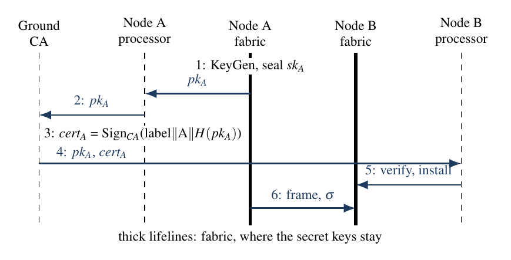
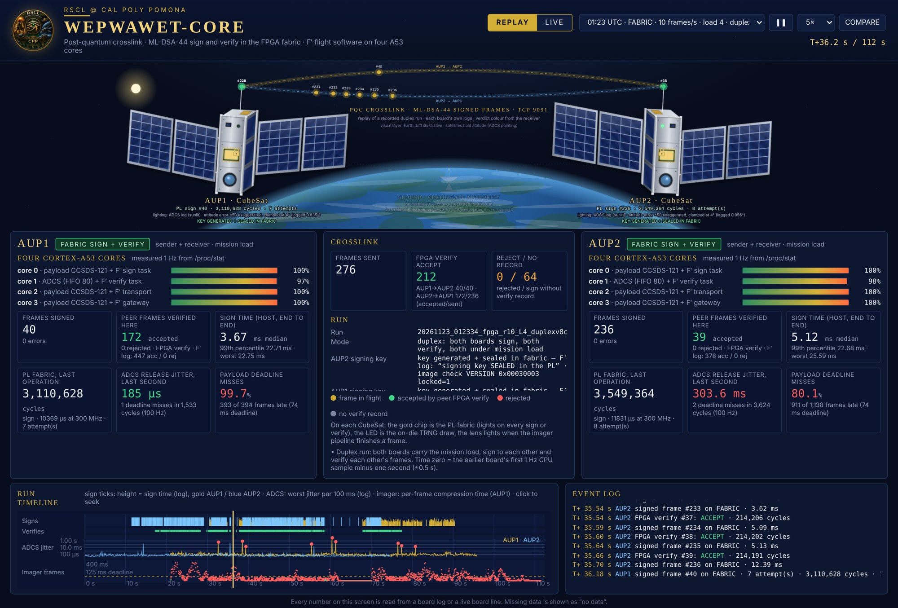

<p align="center"></p>

# WEPWAWET-CORE

**A hardware-resident ML-DSA architecture with fabric-generated, fabric-sealed keys for post-quantum avionics.**

WEPWAWET-CORE puts ML-DSA-44 (FIPS 204) key generation, signing and verification in the FPGA fabric of a
Zynq UltraScale+ node. One ROM microsequencer drives a shared datapath (NTT, inverse NTT, SHAKE-128/256,
polynomial multiply-accumulate) over a four-bank scratchpad. The signing key is generated in the fabric from an
on-die entropy source and stays there: after LOCK the host reads zeros, writes are refused, and the host
sees only the public key. Two AUP-ZU3 boards run NASA F Prime as two CubeSats and exchange signed command
frames in both directions while an attitude-control loop and a CCSDS 121.0 imaging payload load the four A53 cores.

Source-available for research and evaluation. Reconfigurable Space Computing Lab, Cal Poly Pomona.

## Architecture

**One spacecraft node.** Four Cortex-A53 cores run Linux, F Prime, the attitude loop and the imaging payload. The signer, its key and every per-signature secret stay in the fabric behind one AXI4-Lite window, and the processor issues one job per signature.

<p align="center"></p>

**The signing engine.** A 30-state microsequencer fetches 64-bit ROM words and issues either a stream kernel (NTT, inverse NTT, SHAKE, multiply-accumulate) or an RTL unit on the scratchpad banks. A retry manager closes the FIPS 204 rejection loop without the processor. Hatched regions hold the sealed key and seeds and are never readable from the host.

<p align="center"></p>

## Why one job per signature

The same kernels were studied under three control styles. Driving every kernel call from the processor, or chaining kernels per stage, leaves hundreds of milliseconds of bus traffic and waits per signature. Running the whole rejection loop in the fabric brings the total to 7.5 ms.

<p align="center">


</p>

The left plot mixes a measured replay, a model and the board measurement, as labelled. The right plot is a gem5 simulation of the processor side only; the per-signature line is access count times latency, not a simulation.

**Where the cycles of one attempt go.** The coefficient unit and the transforms dominate, not data movement. The lighter bars are a projection for three circuit changes that were not built.

<p align="center"></p>

## Key certification protocol

<p align="center"></p>

1. Each fabric generates its key pair from on-chip entropy, seals the secret key and releases only the public key.
2. The public key is downlinked to the ground.
3. The ground station signs a labelled statement binding the node name to a SHAKE-256 digest of that key.
4. The ground uplinks the peer's public key and certificate.
5. A node installs a peer key only after its fabric verifier accepts the certificate.
6. Crosslink frames are signed in the sender's fabric and verified by the receiver.

Steps 1 and 6 are measured on hardware under mission load. Steps 2 to 5 were exercised on the two boards with fabric-generated keys, including rejection of a key or certificate with one bit altered. See "Security scope and limits" for what this does and does not establish.

## Mission dashboard

<p align="center"></p>

The dashboard replays the recorded runs in `results/` on their real timestamps: both CubeSats, the signed frames in each direction, the verify verdict from the receiver, the four cores of each node, ADCS jitter, payload deadlines, and the key and certificate state. Every number on screen is read from a board log. The picture shows a recorded two-node run on the sealed image.

To see the same thing from a clone of this repository:

```
python3 dashboard/test/serve_test.py        # any OS, replay only, then open http://127.0.0.1:8088/
powershell -ExecutionPolicy Bypass -File .\dashboard\wcore_dash.ps1    # Windows, replay and live boards
```

Pick a run under **DUPLEX** in the run list and press play. Live mode needs the two boards on ssh as `aup1` and `aup2`; see `dashboard/README.md`.

## Results at a glance

| Item | Value |
|---|---|
| Device, clock | AUP-ZU3 (Zynq UltraScale+ ZU3EG), 300 MHz |
| Sealed image (KeyGen + Sign + Verify) | 44,787 LUT, 23 BRAM tiles, 42 DSP, WNS +0.011 ns |
| Unsealed reference image | 45,410 LUT, WNS +0.026 ns |
| KeyGen in fabric | 325,829 and 325,942 cycles on the two boards |
| Sign | 439,317 cycles per attempt + 35,280 fixed (regression over 2,997 signatures) |
| Host time per signature, sealed / unsealed | 0.60 ms / 0.91 ms |
| Board self-test, sealed image | 2,000 / 2,000 on both boards |
| Two-node duplex, sealed image | 1,446 + 1,551 signed; 1,451 + 1,286 accepted; 0 rejected |
| Certified duplex | 463 + 473 signed; 470 + 451 accepted; 0 rejected |
| Host attack after LOCK | every secret read returns 0 and sets the sticky violation flag |

Node 1 under the imaging-pass workload (10 signed commands per second, three runs each):

| Configuration | Signed of 600 | Sign median (ms) | Worst ADCS stall (s) | F Prime aborts |
|---|---|---|---|---|
| No signing | -- | -- | 8.2 | 0 |
| Fabric | 590 / 592 / 590 | 5.31--5.33 | 0.7 | 0 |
| Fabric, unpinned | 295 / 570 / 415 | 5.31--6.73 | 22.0 | 1 |
| Neon (A53) | 285 / 257 / 410 | 0.93--0.98 | 20.9 | 0 |
| Neon, RT priority 70 | 593 / 316 / 592 | 0.92--0.93 | 14.7 | 1 |
| Neon, unpinned | 502 / 590 / 269 | 0.94 | 18.6 | 0 |
| Fabric, sealed | 591 / 171 / 357 | 5.11--5.14 | 21.3 | 0 |
| No signing, repeat | -- | -- | 20.8 | 0 |

The fabric signer is slower per signature than the Neon software signer, and at this command rate offload
does not relieve the mission cores. The contribution is the sealed key and the single-sequencer circuit, measured
under flight software; the tables report both sides. Multi-second ADCS stalls occur on node 1 with and without signing and never on node 2 under the same image and load;
they belong to that board under a stock kernel without real-time patches, not to the signer.

## Repository map

| Folder | Content | Reproduces |
|---|---|---|
| `rtl/sealed_v8/` | RTL of the sealed image as loaded on both boards | Architecture, resource and timing tables |
| `rtl/unsealed_v7/` | Unsealed reference image | Comparison rows |
| `rtl/simulation_only/` | Later variants verified in simulation only, never built or loaded | Forward-looking section |
| `sim/` | Testbenches, vectors (known-answer test keys, never used on a board), Verilator and XSim scripts, profiler | Functional and seal simulation, control-granularity profile |
| `build/` | Vivado batch scripts | Bitstream generation |
| `bitstreams/` | Bitstreams, hardware hand-off files, utilisation and timing reports, SHA-256 list | Resource and timing numbers |
| `driver/` | Userspace driver, self-tests, KeyGen and certificate tools, host attack program, board kit | Self-test, seal attack, certificate check |
| `fprime/` | F Prime components (hardware-accelerator manager, signed transport) and install scripts | Two-node runs |
| `mission/` | ADCS load, CCSDS 121.0 payload load, run harness | Mission workload |
| `ground_ca/` | Ground certificate tool (source only) | Certificate protocol |
| `analysis/` | Scripts that turn logs into the paper's tables | All tables from `results/` |
| `results/` | Board logs, mission runs, board tests, seal review, final CSV | Every measured number |
| `gem5/` | Transaction model and gem5 scripts | Design-space analysis (model, not a board measurement) |
| `dashboard/` | Live and replay dashboard | Visual replay of the runs |
| `tools/wcore.ps1` | Single control script used to drive both boards | Run procedure |

## Requirements

- Two AUP-ZU3 boards with PYNQ Linux, reachable over ssh as `aup1` and `aup2`
- Vivado 2022.2 and Vitis HLS to rebuild; Verilator 5 or XSim to simulate
- F Prime with its GDS, PQClean (ML-DSA-44 clean) and gcc on the boards
- Python 3 for analysis; PowerShell 5.1 or later for `tools/wcore.ps1`
- gem5 (ARM) for the optional transaction study

Board addresses appear as `<AUP1_IP>` and `<AUP2_IP>` and the workstation path as `<WORKDIR>`; set them
for the local setup (see `fprime/PqcTransport.cpp`, `tools/wcore.ps1`, `build/*.tcl`). Absolute host paths
and board addresses in scripts and logs were normalised to these placeholders; nothing else in the logs was changed.

## Security scope and limits

Three things are kept apart.

1. **Fabric-enforced secret isolation: measured.** Seed, expanded key, per-signature randomness and rejected
   intermediates are generated and held in the fabric. After LOCK, host reads of the secret window return zero and
   raise a sticky violation; writes are refused; residue is scrubbed after each signature; zeroize clears the key.
   Tested in simulation and by an attack program run as root on the board.
2. **Authenticated public-key distribution: demonstrated.** A ground key signs each node's public-key digest;
   each node checks the peer certificate with both the fabric and the software verifier. The ground public key is
   a file on the host.
3. **Hardware-rooted identity and attestation: not established.** A root user can load a different bitstream,
   request signatures from the sealed key, or replace the ground public-key file. There is no secure boot, the
   bitstream is not encrypted or authenticated, and side channels and fault injection are untested. The entropy
   source has no NIST SP 800-90B qualification.

The AUP-ZU3 is a commercial board with no radiation tolerance. It is a prototype of the architecture, not flight hardware.

No private key is in this repository. The sealed images generate their own; the ground signing key is kept offline.
The certificates and public keys under `results/certificates/` belong to the test campaign and identify nothing else.

## Licence

PolyForm Noncommercial License 1.0.0 for everything written for this project (RTL, driver, F Prime components,
scripts, documents); see `LICENSE` and `NOTICE`. Commercial use needs a separate licence: mealy@cpp.edu.
Third-party parts keep their own licences; see `THIRD_PARTY_NOTICES.md`.

## Citation

M. El-Hadedy and W.-M. Hwu, "WEPWAWET-CORE: A Hardware-Resident ML-DSA Architecture with Fabric-Generated,
Fabric-Sealed Keys for Post-Quantum Avionics," submitted to IEEE Journal on Emerging and Selected Topics in
Circuits and Systems (JETCAS), 2026.

## Acknowledgments

This work was supported by the Air Force Research Laboratory under Agreement FA8650-24-2-2403, the U.S.
Department of Defense under Award W911NF-24-1-0265, and the U.S. Navy Naval Engineering Education Consortium
(NEEC) under Grant N00174-23-1-0002, and the Office of Naval Research Summer Faculty Research Program. The views and conclusions are those of the authors and do not represent
the official policies of the sponsors or the U.S. Government.

<p align="center">


</p>

Contact: Mohamed El-Hadedy, mealy@cpp.edu
